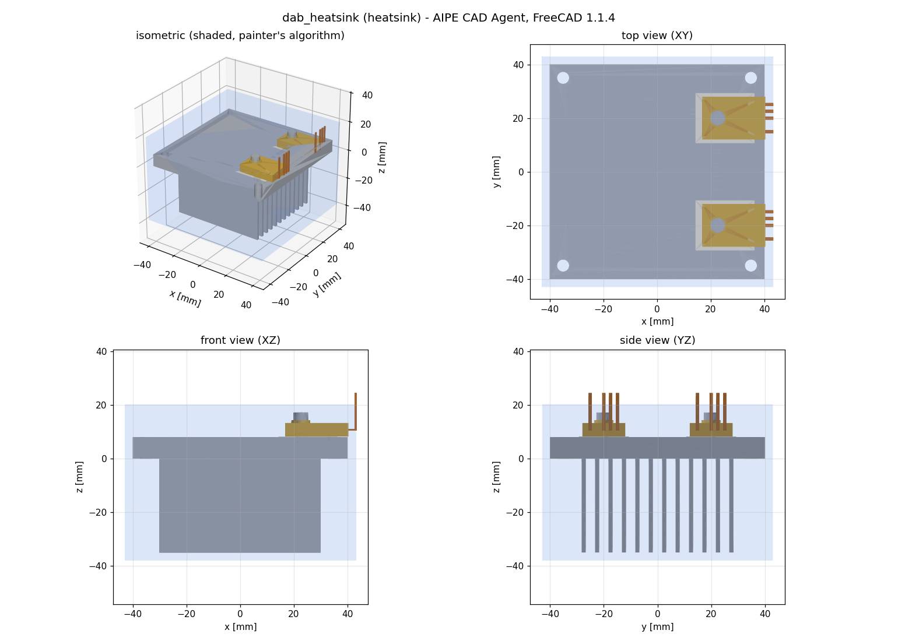
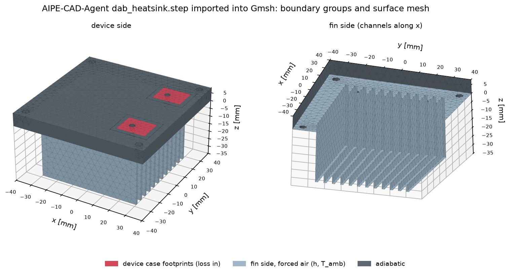
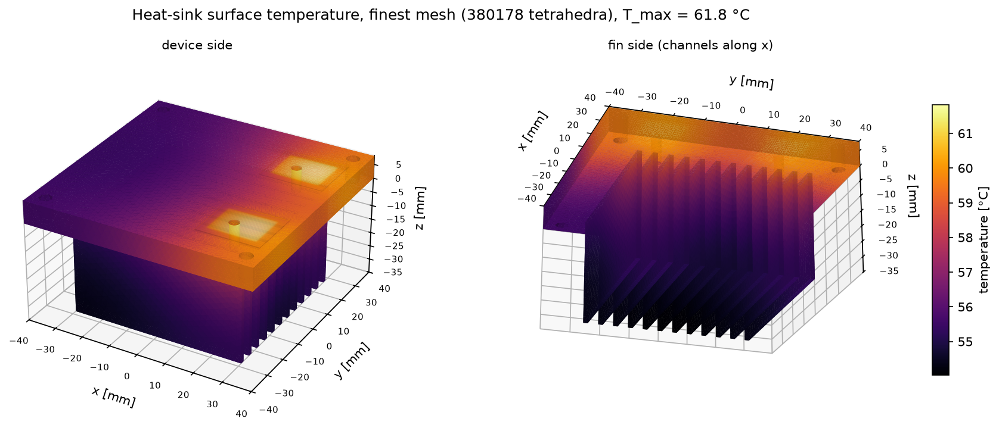
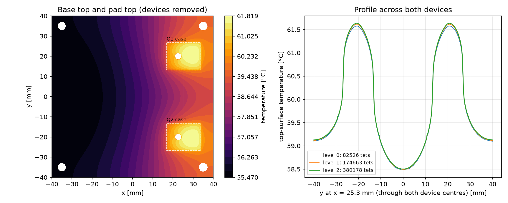
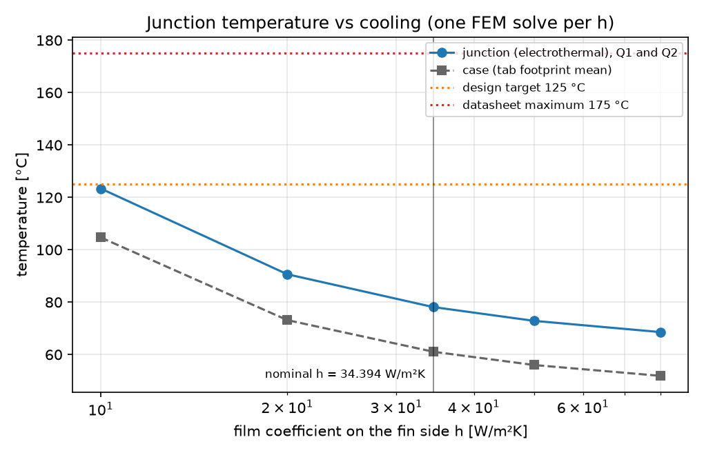
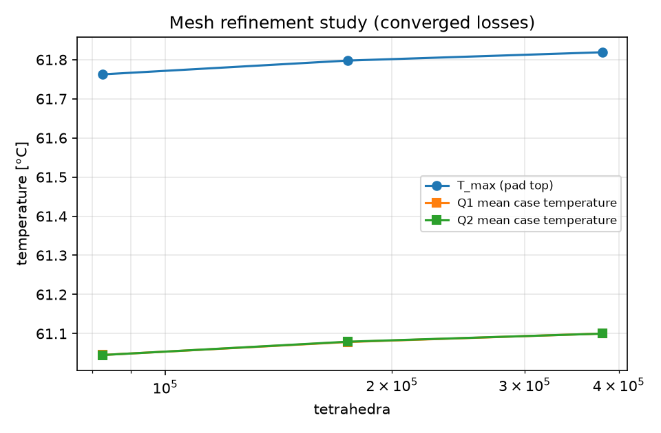

# 10 kW DAB: primary half-bridge heat sink from the AIPE-CAD-Agent model

This example takes the heat sink that **AIPE-CAD-Agent** designed for the 10 kW dual active bridge (800 V to 400 V,
100 kHz) and solves it with Gmsh and Elmer. The CAD model has an 80 x 80 x 8 mm Al-6063 base and 12 fins
(1.5 x 35 mm at 5 mm pitch). It carries two TO-247-4L SiC MOSFETs of one primary half-bridge, each on a 0.25 mm
alumina pad. The device losses come from **AIPE-Thermal-Design's** DAB loss model.

The example answers three questions:

- How hot do the junctions get at the nominal operating point?
- How much margin is there to the 125 °C design target?
- How strongly does the answer depend on the cooling?

| CAD agent render (input) | Imported into Gmsh: boundary groups and surface mesh |
| --- | --- |
|  |  |

## Where every input comes from

| Input | Value | Source |
| --- | --- | --- |
| Geometry | `cad/dab_heatsink.step` (sink, pads, tabs, leads, screws, bushings) | AIPE-CAD-Agent `examples/dab-10kw`, commit `b81bf69` (FreeCAD 1.1.4), copied unchanged with its metadata and parameters |
| Device current | I_rms = 9.67 A per primary switch | AIPE waveform run `dab-l1-nominal-ic`, via AIPE-Thermal-Design `cases/dab_10kw.py` |
| Device loss | P(T_j) = I_rms² x 75 mΩ x f(T_j) + 6.75 W turn-off; f = 1 at 25 °C, 1.7 at 175 °C | C3M0075120K values from the TI TIDA-010054 fact sheet, via AIPE-Thermal-Design. The temperature factor and the turn-off figure are assumptions labelled there |
| R_th,jc | 1.1 K/W | TI fact sheet, via AIPE-Thermal-Design |
| Ambient, limits | 40 °C; T_j design target 125 °C, maximum 175 °C | AIPE-Thermal-Design |
| Film coefficient | nominal 34.394 W/m²K on the fin side, swept from 10 to 80 W/m²K | forced-air value recorded by AIPE-Thermal-Design for its two-fan 100 x 100 x 46 mm option (fin gap 3 mm); the CAD sink is similar, not identical |
| Materials | Al-6063-T5 k = 209 W/m/K; 96 % alumina k = 24 W/m/K | `aipe_fieldsim.materials` |

All inputs are in [`inputs.json`](inputs.json) with these sources written next to them.

## Run it

```sh
python examples/dab_10kw_heatsink/run_example.py                   # about 2 min; needs Gmsh and Elmer
python examples/dab_10kw_heatsink/run_example.py --geometry-only   # STEP import and mesh preview, Gmsh only
```

| Stage | What happens |
| --- | --- |
| 1. Inputs | `inputs.json` is read; the loss model gives 13.76 W at 25 °C and 17.04 W at 125 °C per device |
| 2. Tools | Gmsh, ElmerGrid and ElmerSolver are located |
| 3. CAD import | Gmsh imports the STEP by product name and keeps the sink and both pads. It imprints each tab footprint on its pad (the device case, where the loss enters) and drops the mould bodies, leads, screws and bushings. The faces are then grouped |
| 4. h sweep | One Elmer solve per film coefficient gives the case-to-ambient resistance |
| 5. Electrothermal closure | Conduction with a fixed h is linear in the losses, and the loss is linear in T_j, so T_j = T_amb + P(T_j)(R_case-amb + R_jc) has a closed-form solution |
| 6. Final FEM | The model is re-solved at the converged losses on three meshes (83k, 175k and 380k tetrahedra; the 0.25 mm pads are one element thick on the finest mesh) |
| 7. Checks and report | 11 checks, 5 figures, `report.md`, `example_summary.json` |

The reusable pieces are in the package: `geometry.import_step` / `geometry.cad_device_heatsink` (CAD hand-off)
and `models.CadHeatSinkModel`. Any AIPE-CAD-Agent heat-sink STEP with `<device>.pad` and `<device>.tab` solids works.

## Results (newly executed)

[`results/`](results/report.md) holds the outputs of a GitHub Actions run (Ubuntu 24.04, ElmerSolver 26.2,
Gmsh 4.15.2); [`results/PROVENANCE.md`](results/PROVENANCE.md) names it. CI re-executes the example on every push.

| At h = 34.394 W/m²K, finest mesh | Q1 | Q2 |
| --- | --- | --- |
| Loss (self-consistent with T_j) | 15.50 W | 15.50 W |
| Case temperature, mean / max over the tab footprint | 61.10 / 61.82 °C | 61.10 / 61.82 °C |
| **Junction temperature** (case mean + P x R_th,jc) | **78.2 °C** | **78.2 °C** |
| Margin to the 125 °C design target | 46.8 K | 46.8 K |
| Case-to-ambient resistance, both devices heating | 1.361 K/W | 1.361 K/W |





| Junction temperature vs cooling | Mesh refinement |
| --- | --- |
|  |  |

| h [W/m²K] | 10 | 20 | 34.394 | 50 | 80 |
| --- | --- | --- | --- | --- | --- |
| Junction [°C] | 123.4 | 90.7 | 78.1 | 72.9 | 68.6 |
| Loss per device [W] | 16.98 | 15.91 | 15.50 | 15.33 | 15.19 |

## How to read the results

- **This sink needs the fan.** At the nominal forced-air h the junctions run at 78 °C, leaving 47 K of margin. If
  the airflow collapses to h = 10 W/m²K (typically still more than natural convection gives through 3.5 mm gaps),
  the junctions reach 123 °C, right at the design target.
- **Where the temperature rise goes.** Of the 38 K junction rise:
  - 17 K is the device's own R_th,jc, which no sink can remove;
  - 5.5 K is spreading through the pad and base (case 61.1 °C vs mean fin surface 55.6 °C);
  - 15.6 K is convection.

  Better airflow or more fin area pays most; a thicker base pays least.
- **The devices sit near the base edge.** They are at x = 17-34 mm, but the fins only span x = -30 to +30 mm.
  The top-surface map shows the heat flowing back towards the finned area. Moving the devices inboard, or
  extending the fins, is the obvious next design iteration for AIPE-CAD-Agent.
- **For context only (different models and assumptions):** AIPE-Thermal-Design's analytical forced-air option
  converged at 71.1 °C. TI's reference resistances (0.5 K/W sink) give 77.5 °C.

## Verification checks (all must pass)

| Check | What it guards | Result |
| --- | --- | --- |
| Energy conservation | heat leaving the fin side equals the 31.0 W of losses | 6e-11 |
| VTU vs SaveScalars | an independent numpy re-integration of the fin-side heat flow | 6e-12 |
| STEP volumes vs CAD metadata | the CAD hand-off: imported solids equal the CAD agent's recorded volumes | 9e-16 |
| Case area vs CAD tab | imprinted footprint = tab volume / 1.5 mm | 1e-16 |
| Convective area vs CAD metadata | fin-side area = CAD analytic area minus the six through-hole sections | 6e-16 |
| Case area, Elmer vs Gmsh | the heat flux uses the exact meshed area, so the input power is exact | 5e-14 |
| Linearity in loss | same mesh, two loss levels give the same resistance, which justifies the closed-form closure | 6e-7 |
| Electrothermal consistency | the loss model at the final T_j reproduces the loss that was solved | 5e-5 |
| Device symmetry | the mirror-symmetric devices see the same case temperature | 7e-6 of the rise |
| Mesh sensitivity | the hotspot rise changes by < 2 % between the two finest meshes | 0.1 % |

These checks establish internal consistency and discretisation error only. **Nothing here is validated against
measurements**, and the inputs carry the assumptions listed above.

## Limitations

- **Cooling:** h is a supplied uniform value on the fin side, from a correlation for a similar sink. There is no
  CFD, no radiation, and no air heating along the channels; at the swept airflows the air would warm by a few K.
- **Device and contact:** losses enter as a uniform flux on the tab footprint (no die or package model).
  Contacts are perfect, with no grease, so the case temperature is optimistic by roughly P x 0.05 K/W.
- **Other heat paths:** the base top, edges and holes are adiabatic, and heat through the mould body and leads is
  ignored. Both are conservative.
- **Loss model:** the turn-off placeholder and the R_DS(on) temperature factor are AIPE-Thermal-Design assumptions
  that the semiconductor-database evaluator is meant to replace.
