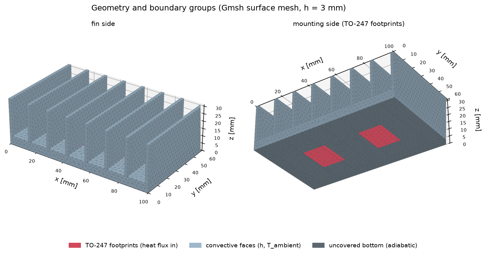
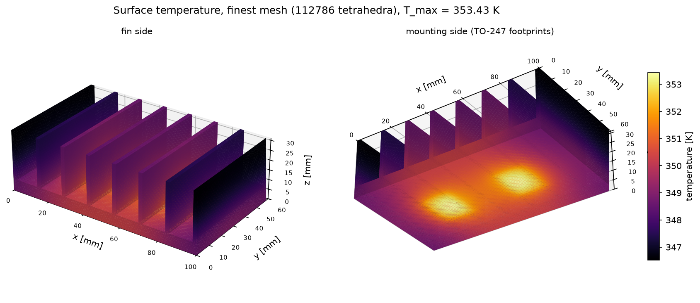
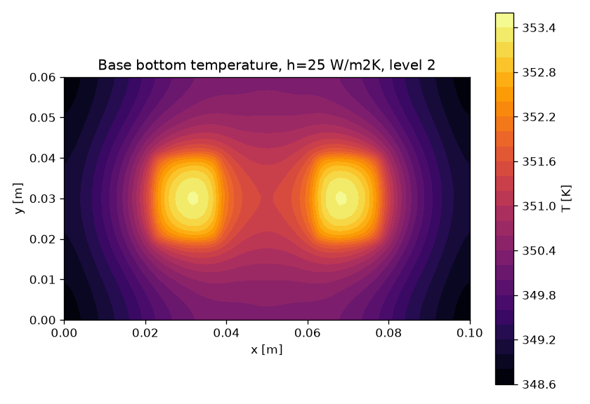
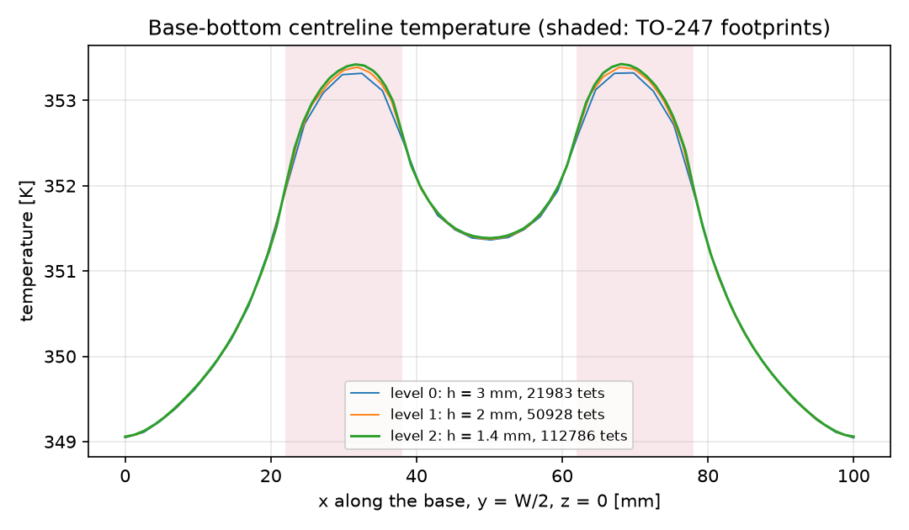
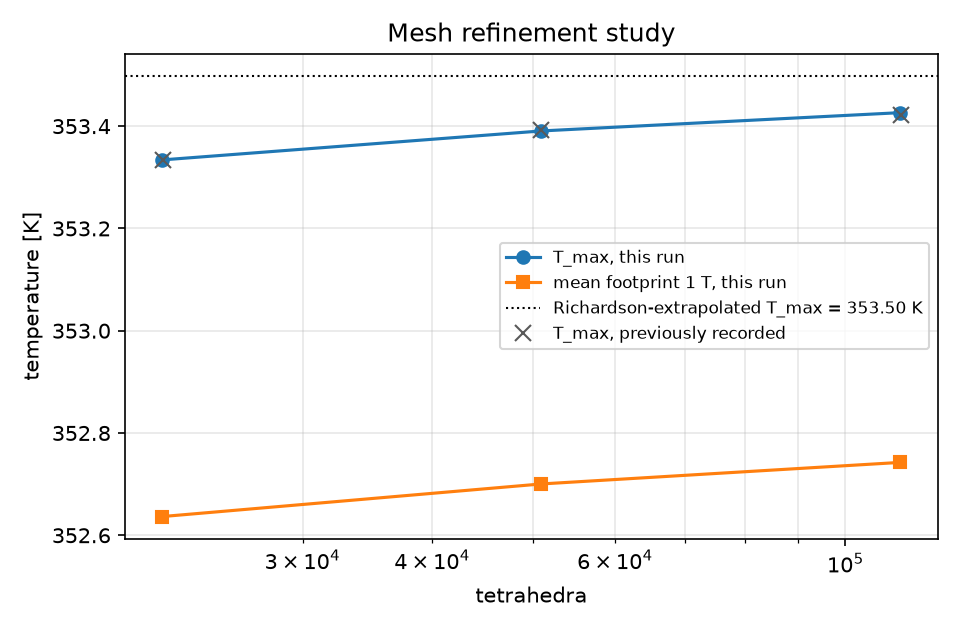

# Heat sink for two TO-247 power devices (Gmsh + Elmer FEM)

Two TO-247 power semiconductors, each dissipating 20 W, sit on a finned aluminium heat sink cooled by natural
convection. The example answers four questions:

- How hot does the mounting surface get?
- Where is the hotspot?
- What is the sink-to-ambient thermal resistance?
- Can the number be trusted numerically?

One script runs the whole chain, from engineering inputs to a 3-D Elmer finite-element solve on three mesh
levels, followed by verification checks, figures and a report.



## Engineering inputs

All inputs are in [`parameters.json`](parameters.json) (SI units; every key names its unit). They are the same
values as the previously recorded run in [`results/heatsink_h25`](../../results/heatsink_h25/summary.json).

| Group | Input | Value |
| --- | --- | --- |
| Geometry | base length x width x thickness | 100 x 60 x 6 mm |
| | fins (straight, full depth) | 8 fins, 2 mm thick, 25 mm tall |
| Devices | power per device | 20 W (40 W total) |
| | footprint per TO-247, uniform heat flux | 16 x 21 mm at x = 30 mm and 70 mm, y = 30 mm |
| Cooling | film coefficient h on every exposed face | 25 W/m²K (natural convection; a supplied value, not CFD) |
| | ambient temperature | 300 K |
| | uncovered base bottom | adiabatic (board side) |
| Material | aluminium (`aipe_fieldsim.materials`) | k = 200 W/m/K |
| Mesh | maximum tetrahedron size per level | 3, 2, 1.4 mm |

## Run it

From the repository root, after `python -m pip install -e ".[mesh,plots]"` and installing Elmer (see
[docs/development.md](../../docs/development.md)):

```sh
python examples/heatsink_to247/run_example.py                       # full run, about 15 s, writes output/
python examples/heatsink_to247/run_example.py --geometry-only       # Gmsh only, no Elmer: geometry figure
python examples/heatsink_to247/run_example.py --parameters my.json  # your own inputs (same keys)
```

The script prints six stages and exits non-zero if any check fails. Without Elmer it stops with an error and
produces no results.

| Stage | What runs | Package module |
| --- | --- | --- |
| 1. Engineering inputs | `parameters.json` is read and validated against the model's parameter names | `models/heatsink.py` |
| 2. Tools | Gmsh, ElmerGrid and ElmerSolver are located and their versions recorded | `tools.py` |
| 3. Geometry and mesh | Gmsh OpenCASCADE builds the base, fins and imprinted footprints with named boundary groups | `geometry.py`, `meshing.py` |
| 4. FEM solve | per level: tetrahedral mesh, ElmerGrid conversion, explicit `case.sif`, ElmerSolver HeatSolve | `physics.py`, `materials.py`, `sif.py`, `elmer.py` |
| 5. Verification | energy balance, independent VTU re-integration, geometry, symmetry, mesh sensitivity, fin theory, recorded run | `postprocess.py`, `analytic.py` |
| 6. Visualisation and report | five figures, `report.md`, `example_summary.json` | `plots.py` |

Outputs (in `output/`, git-ignored):

```
output/
  figures/1_geometry_and_mesh.png ... 5_mesh_convergence.png
  report.md                 all numbers, checks, mesh table and the recorded-run comparison
  example_summary.json      machine-readable: inputs, results, checks, provenance (tool versions, CI run)
  model/summary.json        HeatSinkModel summary with evidence fragments
  model/h25_level{0,1,2}/   full case directories: mesh, case.sif, logs, VTU fields, case.json with SHA-256
```

## Results (newly executed)

The files in [`results/`](results/report.md) come from an execution on GitHub Actions (Ubuntu 24.04,
ElmerSolver 26.2, Gmsh 4.15.2). [`results/report.md`](results/report.md) names the run, and
[`results/finest_case/`](results/finest_case/case.sif) holds the solver input and logs of the finest level.
The CI job re-executes the example on every push.

| Quantity (finest mesh, 112786 tetrahedra) | Value |
| --- | --- |
| Hotspot temperature | 353.43 K (rise 53.43 K above ambient) |
| Mean temperature of each footprint | 352.74 K |
| Thermal resistance, hotspot to ambient | 1.336 K/W |
| Thermal resistance, mean footprint to ambient | 1.319 K/W |
| Heat leaving by convection | 40.0000 W (input 40 W) |



| | |
| --- | --- |
|  |  |



## How to read the results

- **The sink adds about 1.32 K per watt.** For a device on this sink the junction temperature is
  T_j = T_footprint + P (R_th,jc + R_th,cs), with R_th,jc from the device datasheet and R_th,cs from the
  thermal interface material. This model covers neither; it supplies T_footprint.
- **Hotspots sit at the footprint centres** and are only 0.7 K above the footprint mean. Each footprint spreads
  well into the 6 mm aluminium base. Along the base centreline, the region between the devices is about 2 K
  cooler than the hotspots and the base ends about 4.4 K cooler.
- **Convection limits this design, not conduction.** Fin efficiency is 0.97, and the whole surface spans about
  7 K (outer fin tips to hotspot) for a 53 K rise. Raising h (forced air) or adding area lowers the temperature
  almost proportionally; a thicker base or a better alloy would gain little. The previously recorded
  `aipe-fieldsim heatsink --h 80` run gives 0.493 K/W hotspot to ambient ([docs/models.md](../../docs/models.md)).
- **h is the dominant uncertainty.** 25 W/m²K is a typical natural-convection value supplied as an input. A CFD
  or measured h would replace it ([docs/jobs/openfoam-heatsink-cfd-job.md](../../docs/jobs/openfoam-heatsink-cfd-job.md)).

## Verification checks

| Check | What it guards | Result |
| --- | --- | --- |
| Energy conservation | h(∫T dA − T∞A) over the convective faces equals the 40 W input | 9e-16 |
| VTU vs SaveScalars | an independent numpy integral over the VTU faces equals Elmer's boundary integral | 3e-12 |
| Footprint area, convective area | the meshed areas equal the closed-form areas of the parametric geometry | < 1e-15 |
| Footprint symmetry | the two symmetric devices see the same mean temperature | 1.8e-5 of the rise |
| Mesh sensitivity | the hotspot rise changes by < 2 % between the two finest meshes | 0.07 % |
| Fin-theory cross-check | the FEM resistance is 1.0-1.3 x the isothermal-base fin estimate (1.250 K/W, efficiency 0.972). This is a plausibility bound, not a verification | ratio 1.055 |
| Reproduces the recorded run | the hotspot rise matches `results/heatsink_h25` within 1 % | 7.6e-5 |

The FEM numbers are verified for internal consistency and discretisation error. They are **not validated
against measurements**; no measured heat-sink data exists in this repository.

## Previously recorded vs newly executed

- **Previously recorded**: [`results/heatsink_h25`](../../results/heatsink_h25/summary.json), run with
  `aipe-fieldsim heatsink --h 25` on Windows 11 with Elmer 9.0 on 2026-10-21. It is kept unchanged.
- **Newly executed**: [`results/`](results/report.md) in this folder, produced by `run_example.py` in CI.

Both use the same inputs. The meshes differ slightly between platforms (21983 vs 22010 tetrahedra on the coarsest
level), and the hotspot temperatures agree to 0.004 K. The comparison table in `results/report.md` lists every
quantity side by side.

## Limitations

Uniform supplied h, no radiation, no CFD. Each device is a uniform heat flux on its footprint: no package,
thermal interface material or contact resistance is modelled. Conductivity does not depend on temperature. The
uncovered bottom is adiabatic. See [docs/limitations.md](../../docs/limitations.md).
